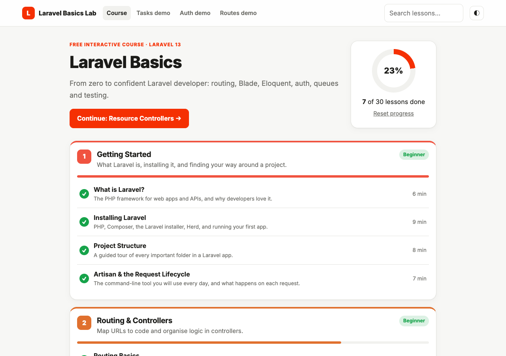
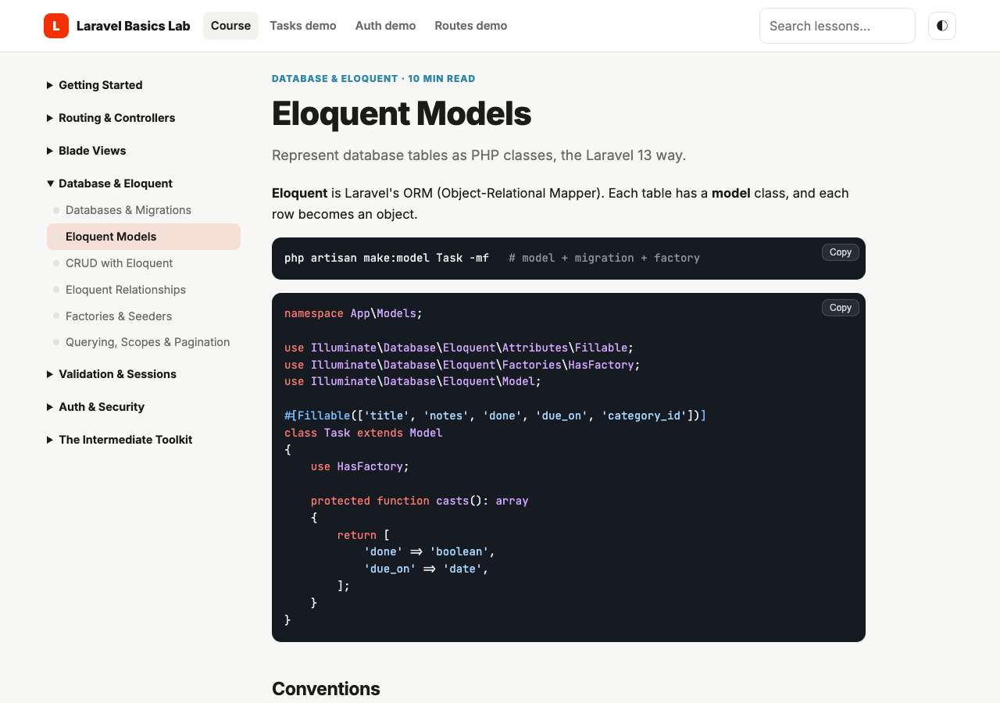
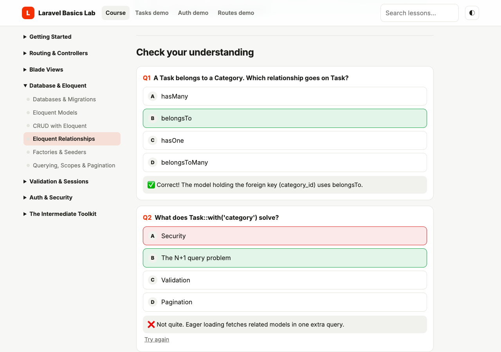
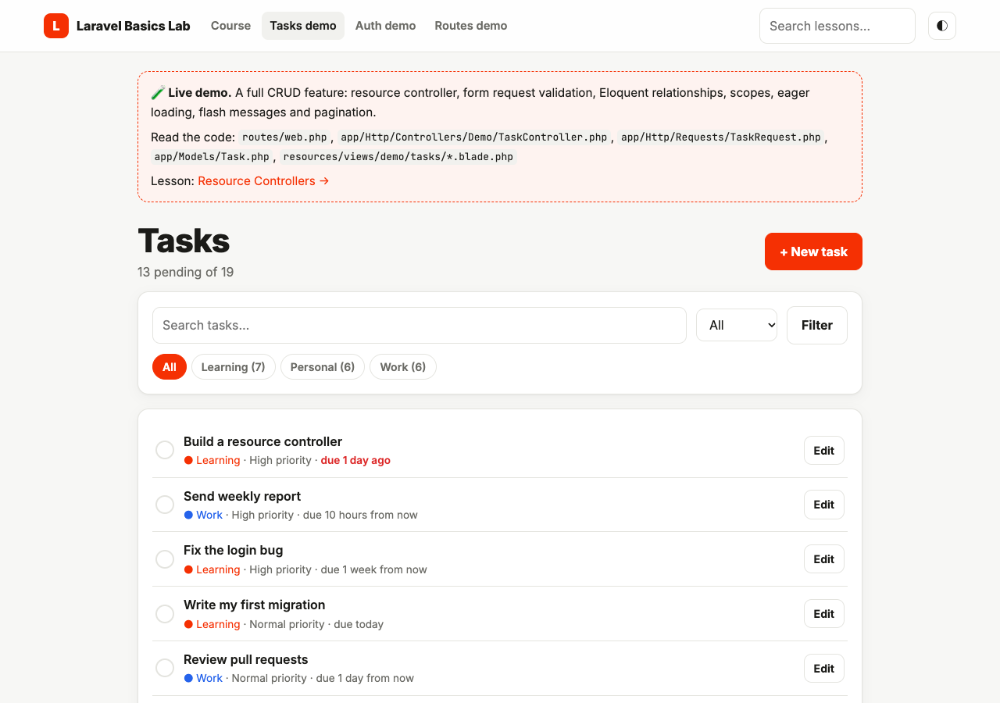
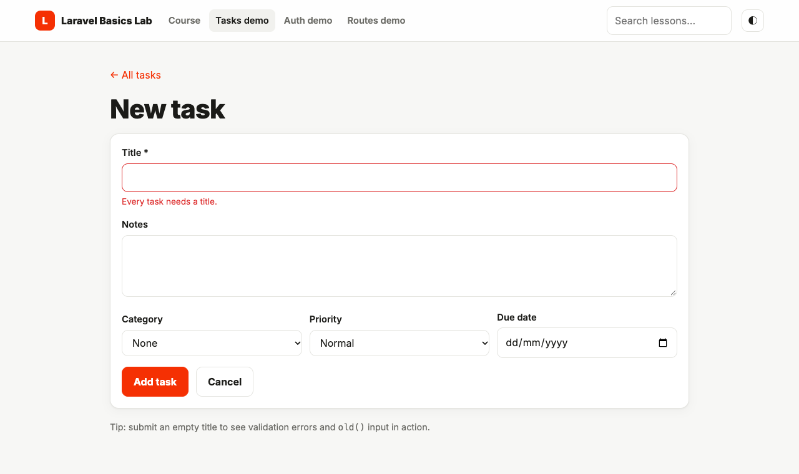
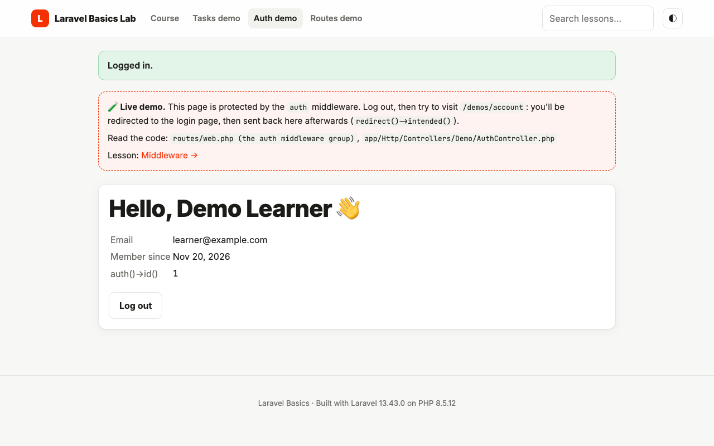
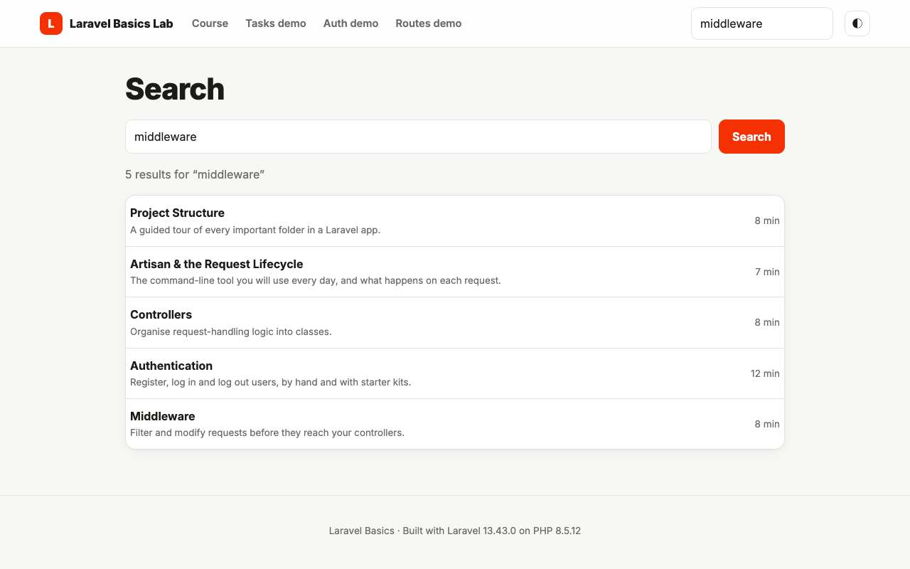
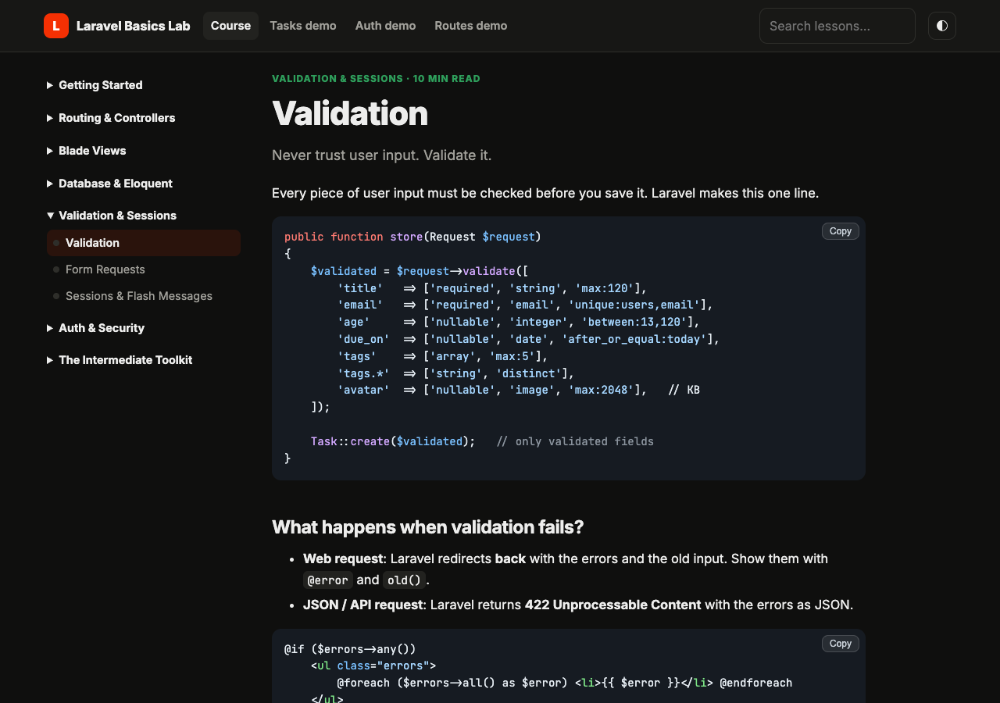
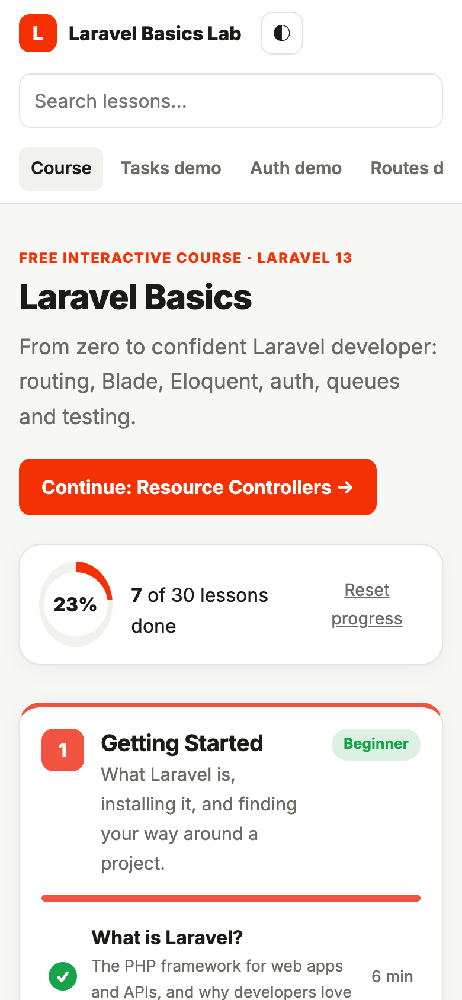

<div align="center">

# Laravel Basics Lab

**An interactive website that teaches Laravel 13 from beginner to intermediate, built with Laravel itself.**

30 lessons with syntax-highlighted code, 83 quiz questions and progress tracking, plus **live demos** you can click
through and then open the source for. No account needed.




</div>

---

## Screenshots

| Lesson | Quiz with instant feedback |
|---|---|
|  |  |
| **Tasks demo (full CRUD)** | **Validation errors and `old()` input** |
|  |  |
| **Auth demo (protected page)** | **Lesson search** |
|  |  |
| **Dark mode** | **Mobile** |
|  |  |

---

## What's inside

### The course: 30 lessons, about 4¼ hours of reading

| # | Module | Level | Lessons |
|---|---|---|---|
| 1 | Getting Started | Beginner | What is Laravel? · Installing Laravel · Project Structure · Artisan & the Request Lifecycle |
| 2 | Routing & Controllers | Beginner | Routing Basics · Route Parameters & Named Routes · Controllers · Resource Controllers |
| 3 | Blade Views | Beginner | Blade Templates · Layouts & Components · Forms & CSRF Protection |
| 4 | Database & Eloquent | Beginner | Databases & Migrations · Eloquent Models · CRUD with Eloquent · Eloquent Relationships · Factories & Seeders · Querying, Scopes & Pagination |
| 5 | Validation & Sessions | Intermediate | Validation · Form Requests · Sessions & Flash Messages |
| 6 | Auth & Security | Intermediate | Authentication · Middleware · Authorization: Gates & Policies |
| 7 | The Intermediate Toolkit | Intermediate | File Uploads & Storage · Mail & Notifications · Queues & Jobs · Events & Listeners · Custom Commands & Scheduling · Testing · Deployment |

Every lesson has:

- Clear explanations with **syntax-highlighted code** and one-click **Copy** buttons
- **Callouts** (tip, note, warning, analogy) for the things beginners trip over
- A **quiz** at the end with instant right/wrong feedback and an explanation for each answer
- **Mark complete & continue** to track progress, previous/next navigation and a module sidebar

The home page shows overall and per-module progress with a **Continue** button. Progress is kept in the session, so there's no sign-up.
**Search** looks across lesson titles and content, and a **light/dark** toggle remembers your choice.

### Live demos: use the feature, then read the code

Each demo carries a banner that names the exact files to open and links to the matching lesson.

| Demo | URL | Shows |
|---|---|---|
| **Tasks** | `/demos/tasks` | Resource controller + extra `toggle` action, Form Request validation, `belongsTo` categories, query scopes, eager loading, filters and search, flash messages, pagination |
| **Auth** | `/demos/register`, `/demos/login`, `/demos/account` | Hand-written register/login/logout, `guest` and `auth` middleware, `redirect()->intended()`, login throttling |
| **Routes** | `/demos/hello/{name?}` | Invokable controller, optional parameter with `whereAlpha`, query strings (`?shout=1`) |

---

## Getting started

### Prerequisites

- PHP **8.3+** with `pdo_sqlite`
- [Composer](https://getcomposer.org)

### Install and run

```bash
git clone https://github.com/tejHacks/laravel_basics_lab.git laravel-basics-lab
cd laravel-basics-lab
composer install
cp .env.example .env
php artisan key:generate
touch database/database.sqlite
php artisan migrate:fresh --seed   # builds the SQLite database with sample tasks and a demo user
php artisan serve                  # open http://127.0.0.1:8000
```

Demo login for the Auth demo:

| Email | Password |
|---|---|
| `learner@example.com` | `password` |

There's no front-end build step. Styles are plain CSS in the layout, and code highlighting loads highlight.js from a CDN.

### Test

```bash
php artisan test
```

20 feature tests cover the course (every module listed, every lesson renders with its quiz, callouts and code, progress,
search by content, 404s), the Tasks demo (listing and filters, create, validation errors, update/toggle/delete, the
`pending` scope and `overdue` accessor) and the Auth and Routes demos (register, validation, log in/out, guest redirects).

---

## Writing and editing lessons

Lessons are plain Markdown files, so no database or admin panel is needed.

```
resources/lessons/
├── curriculum.json        # modules, their order, levels, colours and lesson metadata
├── what-is-laravel.md
├── routing-basics.md
└── …                      # one {slug}.md per lesson
```

A lesson file has front matter, a Markdown body, optional callouts and an optional quiz block:

````markdown
---
title: Validation
summary: Never trust user input. Validate it.
minutes: 10
---
Every piece of user input must be checked before you save it.

```php
$validated = $request->validate(['title' => ['required', 'max:120']]);
```

:::warning
Save `$validated`, never `$request->all()`.
:::

```quiz
[
  {"q": "Which rule requires a matching password_confirmation field?",
   "options": ["same", "confirmed", "match", "equals"],
   "answer": 1,
   "why": "'confirmed' expects {field}_confirmation."}
]
```
````

Callout types: `:::tip`, `:::note`, `:::warning`, `:::analogy`. To add a lesson, create `{slug}.md` and list it under a
module in `curriculum.json`. The test suite checks that every lesson in the curriculum exists and that its quiz parses.

> The same Markdown sources also power the **LaravelLab** Flutter app and the **Laravel API Lab** site.

---

## Project structure

```
app/
├── Lessons/
│   ├── LessonRepository.php    # Loads curriculum.json + Markdown, renders callouts, parses quizzes, search
│   ├── Lesson.php              # A rendered lesson (title, html, quiz, minutes…)
│   └── Progress.php            # Completed lessons, stored in the session
├── Http/Controllers/
│   ├── CourseController.php    # home, lesson, complete, search, reset progress
│   └── Demo/
│       ├── TaskController.php  # Tasks demo (resource controller)
│       ├── AuthController.php  # Auth demo
│       └── HelloController.php # Routes demo (invokable)
├── Http/Requests/TaskRequest.php
└── Models/                     # Task, Category, User
resources/
├── lessons/                    # The course content (Markdown + curriculum.json)
└── views/
    ├── components/             # layout, demo-banner
    ├── course/                 # home, lesson, search
    └── demo/                   # tasks/*, auth/*, hello
routes/web.php                  # Course routes + /demos/* routes
tests/Feature/                  # CourseTest, TaskDemoTest, AuthDemoTest
```

---

## Related projects

- **[Laravel API Lab](https://github.com/tejHacks/laravel-api-lab):** the follow-on course covering REST APIs with Laravel, with a live Books API and API playground.
- **[LaravelLab](https://github.com/tejHacks/laravel_lab):** a Flutter app with 56 Laravel lessons (Basics, APIs, Advanced) for offline learning on your phone.

## License

This project is currently unlicensed. All rights reserved by the author.
